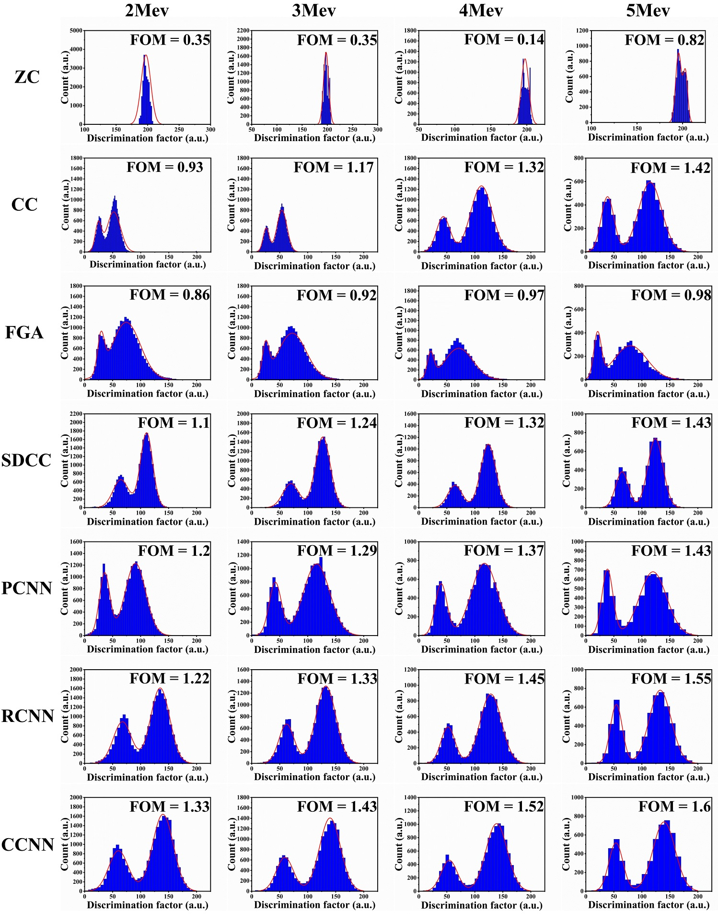

# NeuroPulseDiscriminator — Brain‑inspired neutron/gamma pulse‑shape discrimination

This repository explores neuromorphic models for pulse‑shape discrimination (PSD) between neutron and gamma events. It implements two brain‑inspired networks:

- Random‑Coupled Neural Network (RCNN)
- Continuous‑Coupled Neural Network (CCNN)

Both models leverage temporal dynamics and biologically interpretable mechanisms to separate pulse classes with minimal training. The repo contains:

- Python utilities to prepare datasets and tune model hyperparameters with Optuna
- MATLAB implementations for end‑to‑end PSD experiments




## Repository layout

- `datasetmaker/` — Tools to build PSD datasets from the NE213A time‑of‑flight (TOF) data
  - `TOF_NE213A.py` — create neutron/gamma datasets at configurable energy thresholds
  - `library/` — data processing helpers (Pandas/SciPy/plotting)
- `OPTUNA_PYTHON/` — RCNN/CCNN models and Optuna optimization entry points
  - `RCNN_MODEL.py`, `CCNN_MODEL.py` — core model steps
  - `op_main_rcnn.py`, `op_main_ccnn.py` — Optuna objectives and study runner
  - `Double_guass.py` — two‑component GMM and FOM computation
- `matlabdataset/` — MATLAB reference implementations and dataset tools
  - `rcnntest.m`, `ccnntest.m` — run PSD using RCNN/CCNN in MATLAB
  - `dataset_maker.m`, `data_filter.m` — convert/clean datasets for MATLAB use


## Installation (Python)

Tested with Python 3.11 on Windows. Create a virtual environment and install dependencies:

```bash
python -m venv .venv
.\.venv\Scripts\activate
python -m pip install -U pip wheel
pip install numpy scipy pandas matplotlib tqdm scikit-learn optuna opencv-python
# Optional helpers used by some utilities
pip install dask[complete] lmfit scikit-image imageio
```

Notes
- If you run into backend issues for Matplotlib on Linux, install Tk: `sudo apt-get install python3-tk` and set `matplotlib.use('TkAgg')` (already set in `TOF_NE213A.py`).


## Datasets

Download the NE213A TOF dataset file `NE213A_data.pkl` from Zenodo and place it next to `TOF_NE213A.py`:

[Dataset on Zenodo (DOI: 10.5281/zenodo.14305929)](https://doi.org/10.5281/zenodo.14305929)

Expected location:

```
datasetmaker/
  NE213A_data.pkl
  TOF_NE213A.py
```

The script now resolves paths relative to its own directory, so you can run it from anywhere.


## Create neutron/gamma datasets at energy thresholds

Edit `datasetmaker/TOF_NE213A.py`:

- Set the energy window:
  - `energy_threshold_low`
  - `energy_threshold_up`
- Optional: adjust `PS_cut` and TOF windows defined at the top of the file

Run the script (quotes handle spaces in the folder name):

```bash
python "datasetmaker/TOF_NE213A.py"
```

This produces two arrays saved next to the script in a dynamically created folder named by the threshold, e.g. `NE213A_1.5Mev/gamma_1.5Mev.npy` and `NE213A_1.5Mev/neutron_1.5Mev.npy`.


## Hyperparameter optimization with Optuna (Python)

Entry points:

- RCNN: `OPTUNA_PYTHON/op_main_rcnn.py`
- CCNN: `OPTUNA_PYTHON/op_main_ccnn.py`

Both expect a 2D array of signals where each row is one waveform.

Supported input formats for `file_path` in both scripts:

- CSV: `np.loadtxt(file_path, delimiter=',')`
- NPY: `np.load(file_path)`

They use SQLite in the working directory by default:

- RCNN: database `optuna_rcnn_fom2.db`, study `optuna_rcnn_fom2`
- CCNN: database `optuna_ccnn7.db`, study `optuna_ccnn7`

Run from the repo root:

```bash
python "OPTUNA_PYTHON/op_main_rcnn.py"
python "OPTUNA_PYTHON/op_main_ccnn.py"
```

The objective computes a PSD score per signal, fits a 2‑component Gaussian Mixture, and maximizes the figure of merit (FOM):

\[ \mathrm{FOM} = \frac{\mu_1 - \mu_0}{1.667\,(\sigma_1 + \sigma_0)} \]


## MATLAB workflows

If you prefer MATLAB, use the scripts in `matlabdataset/`:

- Build/convert datasets: `dataset_maker.m`, `data_filter.m`
- Run PSD: `rcnntest.m` and `ccnntest.m`

The Python and MATLAB workflows can be mixed: generate `.npy` with Python, convert to `.mat` via `dataset_maker.m`, then run MATLAB PSD; or prepare CSV and run Python Optuna.


## Dependencies (Python)

- numpy, scipy, pandas, matplotlib, tqdm
- scikit‑learn (GaussianMixture)
- optuna (hyperparameter optimization)
- opencv‑python (`cv2`, used by RCNN)
- Optional: dask, lmfit, scikit‑image, imageio


## Citation

If you use this repository in your research, please cite the published article:

Yihan Zhan, Haoran Liu, Mingzhe Liu, Peng Li, Kaimin Wang, Zhuo Zuo, Xianghe Liu, and Bingqi Liu. **Pulse Shape Discrimination of Neutrons and Gamma Rays Using Neuromorphic Models.** *Nuclear Technology*, published online February 19, 2026. [Published article](https://doi.org/10.1080/00295450.2025.2598528)

```bibtex
@article{zhan2026pulse,
  author = {Zhan, Yihan and Liu, Haoran and Liu, Mingzhe and Li, Peng and Wang, Kaimin and Zuo, Zhuo and Liu, Xianghe and Liu, Bingqi},
  title = {Pulse Shape Discrimination of Neutrons and Gamma Rays Using Neuromorphic Models},
  journal = {Nuclear Technology},
  year = {2026},
  doi = {10.1080/00295450.2025.2598528}
}
```


## References

- Optuna: Akiba, Takuya, et al. “Optuna: A next‑generation hyperparameter optimization framework.” Proceedings of KDD 2019.
- Dataset: NE213A TOF on Zenodo: 10.5281/zenodo.14305929


## License

This project is licensed under the MIT License - see the [LICENSE](LICENSE) file for details.

## Notes and caveats

- Randomness in RCNN (stochastic masks) and GMM fitting may cause small run‑to‑run variations; set seeds if you need strict reproducibility.
